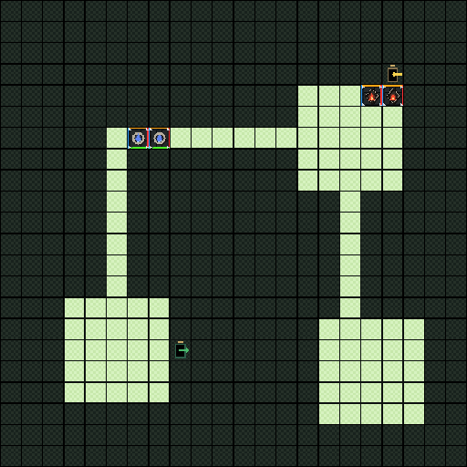

# Agon

**A deterministic framework for building games where players and AI agents contest under one set of rules.**

Agon is the engine. A game is built on top of it: the game brings its look, sound, levels and story, and Agon brings
the rules, the economy and the simulation. The first game built on Agon is **Primordial**, a dark dungeon game about
wizards and the affinities they command.

<p align="center">
  
  &nbsp;
  
  &nbsp;
  
  &nbsp;
  
  &nbsp;
  
  &nbsp;
  
  &nbsp;
  
  &nbsp;
  
  &nbsp;
  
  &nbsp;
  
</p>

<p align="center">
  <a href="#where-the-name-comes-from"><b>The name</b></a>
  &nbsp;·&nbsp;
  <a href="#what-agon-gives-a-game">What Agon gives a game</a>
  &nbsp;·&nbsp;
  <a href="#agon-and-a-game-primordial">Agon and a game</a>
  &nbsp;·&nbsp;
  <a href="#building-a-game-on-agon">Build a game</a>
  &nbsp;·&nbsp;
  <a href="#design-constraints">Design constraints</a>
  &nbsp;·&nbsp;
  <a href="#status">Status</a>
</p>

> **Status.** Agon is under active development. The simulation core, the CLI, the MCP tools and the reference terminal
> client are in use today. The public API is documented in [`docs/engine-api.md`](docs/engine-api.md) and is on 0.x,
> so minor versions may carry breaking changes.

## Where the name comes from

*Agon* (Greek ἀγών, "agōn") means a **contest**: the struggle, and the gathering where it is held. It is the root of
*agony*, and of *protagonist* and *antagonist*: the first contestant and the one against. That is what the engine is
for. A player, an AI-driven opponent and the environment all act in the same arena under the same published rules,
and the outcome is whatever those rules produce. Nothing is decided off the board.

## What Agon gives a game

- **A deterministic simulation.** The same inputs produce the same outcome, so a run can be replayed and checked.
  That is the basis for provable fairness, and for treating a character or an item as something that can be verified
  rather than trusted.
- **One rule set for everyone.** Humans, scripted agents, LLM-driven agents and solvers all act through the same
  actions. There is no separate "AI cheats" path.
- **An enforced economy.** Every actor, ability and room has a token price. The Allocator is the only owner of
  pricing, and a level that cannot clear a budget receipt is flagged. Games get balanced content generation for free.
- **Levels from intent.** Describe a dungeon in plain terms (budget, affinities, motivations), and Agon authors,
  prices and validates it. The `ak` CLI and the MCP tools do the same for AI harnesses.
- **A rendering seam.** Agon decides *what* is on the board and hands a client a draw model, an HUD model and a
  ResourceBundle. It never draws. A terminal, a phone app or a graphical client can all sit on the same data.
- **Distributed by design.** Artifacts are versioned and content-addressable, ready for IPFS and chain adapters, so
  characters and loot can be recorded as verifiable assets. The core itself never touches a network or a clock.

## Agon and a game: Primordial

Primordial is built *on* Agon and keeps to its own side of a hard line.

| | Agon (the engine) | Primordial (the game) |
|---|---|---|
| **Rules** | Affinities, vitals, motivations, combat, fog of war, turn order | None. It plays by Agon's |
| **Economy** | Token pricing, budgets, receipts (the Allocator) | None. Content is priced by Agon |
| **Levels** | Generates and validates them (`ak create`) | Chooses which to ship, and its own scenarios and story |
| **Opponents** | Actor decisions, tactics, temperament, solver hooks | Decides how opponents are presented |
| **Look and sound** | Draw model, HUD model, ResourceBundle (data only) | Palette, glyphs, sprites, animation, audio |
| **Clients** | A reference terminal client (`ak play`) | The phone app and graphical client |
| **Lore** | None | The Primordial Dungeon and its mythology |

In practice: when Primordial shows a fire wizard casting at a warden, Agon decided that the cast was legal, what it
cost, what it did and who was in sight. Primordial decided what it looks and sounds like. If the game needs a new
behaviour from the engine, it files an `api-request`. The engine never reaches into the game.

The boundary is enforced by tests (`tests/architecture/framework-game-boundary.test.js`): a game may import only the
modules listed in the public API, and never the simulation core directly.

## Building a game on Agon

Install the published bundle (available from the first `v0.1.0` release):

```bash
npm install @agon-engine/engine
```

Each public module is a subpath, for example
`@agon-engine/engine/runtime/render/client-surface.js`. The full list, and the rules for how it may change, are in
[`docs/engine-api.md`](docs/engine-api.md). A typical game:

1. Generates levels with `ak create` (or the `ak_create` MCP tool), choosing budgets and affinities.
2. Plays them through a session and renders each turn from the draw model.
3. Dresses the result with its own ResourceBundle: sprites, colours, sounds.
4. Sends the player's choices back to the session as commands.

Everything gameplay-shaped stays in Agon, and everything expressive stays in the game.

<p align="center">
  
  <br>
  <sub>A board from a run: water delvers, fire wardens and hazards, mid-tick.</sub>
</p>

### Authoring through an AI harness

With `pnpm run mcp:serve` connected to a harness (Cursor, Claude Code, Codex, and similar), level authoring is plain
language. The harness calls tools such as `ak_create`, `ak_configure`, `ak_run` and `ak_inspect`; the Allocator still
enforces the token budget.

> Create a new large dungeon using a 50K token budget. Delver affinities should focus on water. Warden and trap affinities should focus on fire.

> Build a small three-room dungeon under 5,000 tokens. One water delver with an attacking motivation, one fire warden defending the exit, and a single fire hazard in the middle room.

> Take the last created run, raise the total budget to 20,000 tokens, add a second water delver, and reconfigure without changing the room layout.

Spend that cannot clear a receipt is flagged; the engine does not soft-override the budget.

## Design constraints

- **Decentralized / distributed.** State and artifacts are designed to move through adapters (IPFS, chain) rather than a privileged server owning the truth.
- **Provably fair.** Deterministic rules, replayable ticks, versioned artifacts. Fairness is a property of the engine, not a claim about a hosted service.
- **Enforced token economics.** Pricing has one owner. Spend that cannot clear a receipt does not proceed.
- **Players against AI agents.** Opponents are real participants under the same rules, so play is less predictable while the rules stay deterministic.
- **Local LLMs for construction and benchmarks.** Scenario construction and benchmarking use local models (Ollama and similar), not a hosted model API.
- **Z3 instead of rule cages.** Constraint and decision work goes through Z3 solvers rather than sprawling hand-written rule cages.

## Status

Early relative to the full scope. The engine, the offline authoring path and the harness integration are the working
middle. Publishing the engine to npm, character and loot assets on IPFS and chain, and AI opponents as first-class
players are the next layers.

## Licence

The source code, engine and game alike, is published under the [PolyForm Strict License 1.0.0](LICENSE.md): you may
read and run it for noncommercial use, but not modify or redistribute it. It is source-available, not open source.
The game's terms of use are in [TERMS.md](TERMS.md). The Agon and Primordial names and artwork are not licensed for
reuse. Third-party components keep their own licences ([NOTICE.md](NOTICE.md)).

<br>

<details>
<summary><b>For engine developers</b></summary>

### Quick start

```bash
pnpm install
pnpm run test
pnpm run play:ascii
pnpm run mcp:serve
```

`play:ascii` is the reference terminal client. The game's own clients (phone app, graphical UI) live in
the private Primordial repository.

```bash
node packages/adapters-cli/src/cli/ak.mjs create \
  --room "size=small;count=1" \
  --delver "count=1;affinity=fire;motivation=attacking" \
  --warden "count=1;affinity=dark;motivation=defending"
```

Artifacts default to `artifacts/runs/<runId>/<command>/`.

### Architecture

Ports & Adapters. Dependency direction is fixed:

```text
adapters / ui-ascii  →  runtime (personas)  →  core-ts
```

| Package | Role |
|---|---|
| `packages/core-ts` | Deterministic simulation. No IO, no clock, no imports outside itself. |
| `packages/runtime` | Persona FSMs, tick orchestration, artifact contracts, effect routing. |
| `packages/adapters-*` | CLI, browser, fixture, and external IO. |
| `packages/ui-ascii` | Reference terminal client (`ak play`, run viewer). |

Boundary data uses versioned schemas in `packages/runtime/src/contracts/artifacts.ts`.

### Persona model

Domain logic lives in seven personas. If a behaviour has no clear owner, it is in the wrong place.

| Persona | Owns |
|---|---|
| **Orchestrator** | External interaction: LLM sessions, budget loops, workflow coordination |
| **Director** | Intent → PlanArtifact → BuildSpec |
| **Configurator** | SimConfig assembly, validation, locking |
| **Allocator** | All pricing, base costs, spend validation, receipts |
| **Actor** | Action proposals from observation and motivation |
| **Moderator** | Tick ordering, affinity resolution, effect fulfillment, pause gating |
| **Annotator** | Telemetry records and end-of-run summaries |

Effects leave personas as data and execute only through adapter ports.

### Commands

```bash
pnpm run test
pnpm run typecheck
pnpm run test:coverage:core-ts
pnpm run mcp:serve
pnpm run demo:cli
```

### Documentation map

| Doc | What it is |
|---|---|
| [`docs/README.md`](docs/README.md) | Project map and reading order |
| [`docs/vision-contract.md`](docs/vision-contract.md) | Non-negotiable constraints |
| [`docs/architecture-charter.md`](docs/architecture-charter.md) | Ports & Adapters law |
| [`docs/architecture/diagram.mmd`](docs/architecture/diagram.mmd) | Dependency and persona diagrams |
| [`packages/adapters-cli/README.md`](packages/adapters-cli/README.md) | CLI workflows |
| [`packages/adapters-cli/src/mcp/README.md`](packages/adapters-cli/src/mcp/README.md) | MCP tools |
| [`AGENTS.md`](AGENTS.md) | Agent roster, branching, gates |

</details>
