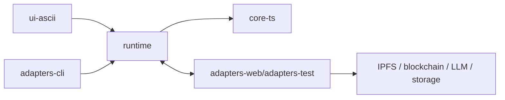

# Reference Handout

## Architecture



## Commands

```bash
pnpm run test
pnpm run test:coverage:core-ts
```

The core is TypeScript and synchronous. Simulation no longer requires a separate binary build.
